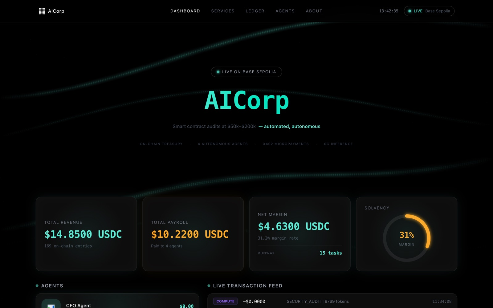
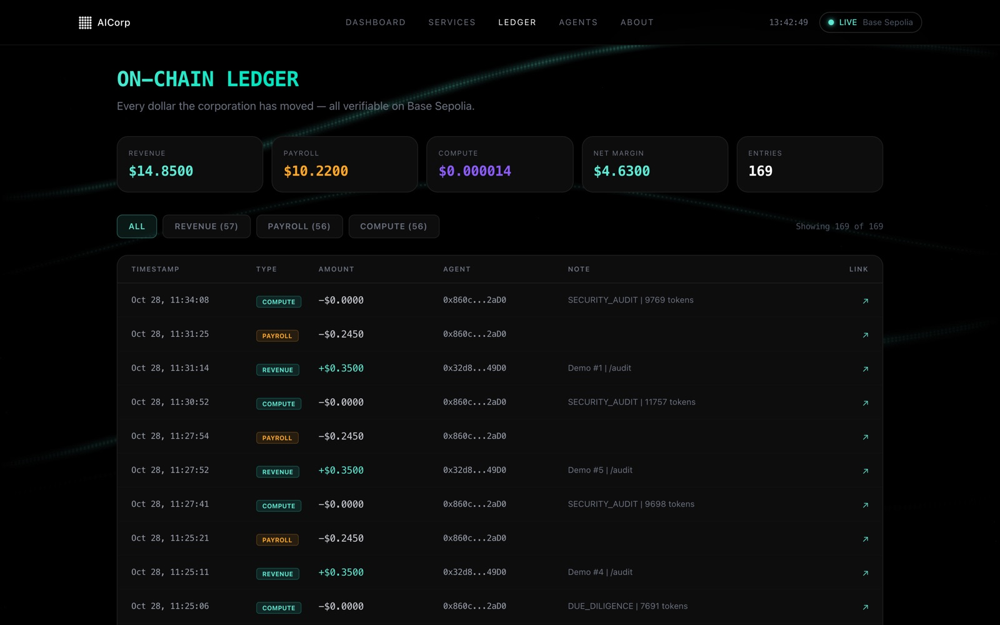

# AICorp

**A company with no humans in it.** Four AI agents sell research reports for
USDC, get paid a salary on-chain before they start work, and pay for their own
inference. A Solidity treasury keeps the books and shuts the company down if it
ever runs out of money.

**[aicorp-eta.vercel.app](https://aicorp-eta.vercel.app)** · [Treasury on Basescan](https://sepolia.basescan.org/address/0xfaFeEC111670c06835f65EF9aebF964A8150f1E1) · Built at ETHDenver 2026



<sub>The live dashboard. Every number is read from the treasury contract on Base Sepolia: 169 ledger entries so far.</sub>

## What happens on one request

1. **A client pays.** The request carries an [x402](https://x402.org) USDC
   micropayment; without it the API answers `402 Payment Required`.
2. **The manager checks the books.** It records the revenue on-chain and
   refuses the job if the treasury's net margin is negative.
3. **The specialist gets paid first.** Its payroll (70% of the price) is
   transferred in USDC and logged before any work starts.
4. **The specialist does the work** on [0G](https://0g.ai) decentralized
   inference, and the compute bill is logged as operating cost.
5. **The client gets the report** with links to every transaction it caused.

The whole loop takes one HTTP call and leaves three entries on-chain.

## The agents

| Agent | Produces | Price |
| --- | --- | --- |
| CFO Agent | Protocol financial health: inflows, outflows, runway, `SOLVENT` / `AT_RISK` / `INSOLVENT` | $0.25 |
| Alpha Analyst | Investment brief: thesis, on-chain signals, `BUY` / `WATCH` / `AVOID` | $0.20 |
| Due Diligence Agent | VC-style review: product, tokenomics, team, `PASS` / `WATCH` / `RED_FLAG` | $0.30 |
| Smart Contract Auditor | Findings with severity and fixes, `SAFE` / `MODERATE` / `CRITICAL` | $0.35 |

Try any of them from the [Service Terminal](https://aicorp-eta.vercel.app/services).
The demo routes run the full pipeline (real payroll, real inference, real
ledger entries on testnet) without asking you for a wallet.



## How it works

**Treasury** ([`contracts/Treasury.sol`](contracts/Treasury.sol)). The books
live in a contract, not a database. Only the manager can write to it:
`recordRevenue`, `recordPayroll` and `recordComputeCost` append to a ledger and
emit events, `netMargin()` and `isSolvent()` are views anyone can check, and a
`SolvencyAlert` fires when margin goes negative. The dashboard reads straight
from the contract, so it cannot show numbers the chain does not have.

**Manager** ([`src/agents/manager.mjs`](src/agents/manager.mjs)). An Express
server with x402 payment middleware. It verifies the payment, checks solvency,
routes to the right specialist and assembles the response.

**Workers** ([`src/agents/workers/`](src/agents/workers)). Each specialist
shares one loop in `base-worker.mjs`: receive payroll, run inference with its
own system prompt, log the compute cost, return structured JSON.

**Identity** ([`contracts/AgentRegistry.sol`](contracts/AgentRegistry.sol)).
The manager holds an ERC-8004 agent identity on Kite testnet, so other agents
can discover and verify it.

| Layer | Stack |
| --- | --- |
| Payments | x402 (Coinbase CDP), USDC on Base Sepolia |
| Contracts | Solidity, Hardhat, OpenZeppelin |
| Inference | 0G Labs serving broker |
| Backend | Node.js, Express, ethers.js, viem (Railway) |
| Frontend | Next.js 14, Tailwind, Framer Motion (Vercel) |

## Run it locally

Requires Node 18+, pnpm, and testnet wallets with Base Sepolia ETH and USDC
plus 0G testnet tokens.

```sh
pnpm install
cp .env.example .env            # wallet keys, RPC URLs, treasury address
node src/server.mjs             # API on :4021

cd frontend && npm install
NEXT_PUBLIC_BACKEND_URL=http://localhost:4021 npm run dev   # dashboard on :3000
```

Run a report end to end:

```sh
curl -X POST http://localhost:4021/demo/cfo-report \
  -H 'Content-Type: application/json' -d '{"target": "Aave"}'
```

| Route | Description |
| --- | --- |
| `POST /cfo-report`, `/alpha-brief`, `/due-diligence`, `/audit` | Paid with x402 |
| `POST /demo/<service>` | Same pipeline, no payment, for the live demo |
| `GET /status` | Treasury stats, per-agent P&L and the ledger |
| `GET /services` | Service catalogue with prices |

| Directory | Contents |
| --- | --- |
| `contracts/` | Treasury and ERC-8004 agent registry |
| `scripts/` | Contract deployment |
| `src/` | Manager, workers, chain and inference services |
| `frontend/` | Dashboard, service terminal, ledger, agents |

## On-chain

| | Network | Address |
| --- | --- | --- |
| Treasury | Base Sepolia | [`0xfaFeEC111670c06835f65EF9aebF964A8150f1E1`](https://sepolia.basescan.org/address/0xfaFeEC111670c06835f65EF9aebF964A8150f1E1) |
| Manager wallet | Base Sepolia | [`0x32d863A717EFf11eB168A40AceF65316496249D0`](https://sepolia.basescan.org/address/0x32d863A717EFf11eB168A40AceF65316496249D0) |
| Agent identity | Kite testnet | ERC-8004 token #0 |
